# 智学研途 AI 个性化学习平台（StudyPath AI）软件说明书与用户手册

版本：V1.2　　著作权人：戴云龙　　开发完成日期：2026 年 10 月 22 日　　文档修订日期：2026 年 10 月 23 日

## 1. 文档说明

本说明书与用户手册介绍智学研途 AI 个性化学习平台的产品定位、系统组成、学习者操作流程、课程维护方式、资料问答机制和常见问题。主要读者包括使用平台学习的学生、负责课程内容维护的管理员，以及进行本地部署和日常维护的技术人员。

本文依据当前平台界面、用户提供的操作说明和所附系统截图编写。截图用于对应说明页面结构、操作入口及典型流程。截图中的课程名称、学习数据和问答文本属于拍摄时页面呈现的示例或账号数据，实际内容取决于登录账号、课程数据和部署配置；截图不应作为学习成绩、模型性能或服务可用性的承诺。个别流程（如答错后错题入库、原题与变式复测）按产品操作逻辑说明，当前配图没有单独展示其结果页面。

## 2. 软件概述

智学研途 AI 个性化学习平台（StudyPath AI）是一套面向课程学习和个人学习管理的浏览器软件。系统围绕“资料和课程—知识点—学习路径—练习反馈—复习计划”组织学习活动，并提供基于个人资料检索的 AI 智能答疑。学生可以从首页了解学习状态、选择课程或学习任务；也可以上传自己的资料建立知识库，通过问答和练习巩固知识。

系统的主要学习闭环如下：

1. 学习者登录后从学习总览检查课程、近期任务、掌握情况和复习建议。
2. 学习者在学习资料库创建知识库并上传资料；文档经过解析和索引后可用于资料检索与问答。
3. 学习者进入我的课程查看课程目录、章节与知识点，并通过课程知识图谱查看先修和关联结构。
4. 系统依据课程知识关系、账号掌握情况和错题复习状态形成个性化学习建议；学习者可以结合自己的目标调整或采用建议。
5. 学习者对课程或指定知识点进行练习。答题结果用于展示掌握反馈；答错题目可进入错题本，通过原题复习及变式复测加强理解。
6. 学习者把推荐步骤加入学习计划，设置日期、任务和优先级，在日常学习中执行并查看完成情况。
7. 学习者可在 AI 智能答疑中提出问题，系统在选定知识库范围内检索资料片段，回答时提供可核对的来源。

系统主要由 Vue 3、TypeScript 前端和 Python FastAPI 后端组成。前端通过 HTTP API 调用账号、课程和学习业务；关系数据库保存账号与学习记录；资料问答依部署配置使用文档解析、向量检索、重排及模型服务。用户界面所称的“本地资料检索”表示检索范围受用户知识库和账号权限约束，模型推理服务可能由部署方配置为本机或外部服务，具体以服务端设置为准。

## 3. 用户角色与主要数据

### 3.1 学习者

学习者可以查看课程、知识图谱和个人学习路径，创建学习任务与知识库，上传个人资料，参加练习和测验，查看错题与学习统计，并与 AI 助手围绕已选资料进行问答。个人掌握度、任务状态、问答历史和错题记录随当前登录账号读取。

### 3.2 课程维护人员

具有课程维护权限的人员可以新增或维护课程、知识点、知识点关系和课程练习题。课程目录和先修关系会影响学生侧目录、图谱、路径推荐及练习入口。管理员凭据只用于课程维护页面的当前操作，应通过安全方式交给服务端，不应在公共设备上长期保留。

### 3.3 数据边界与隐私

个人上传资料和学习记录应在用户账号授权范围内读取。切换账号后应确认页面加载的是目标账号数据。不要上传密码、模型服务密钥、证件号码等与学习无关的敏感信息。使用 AI 问答前，应确认部署方对模型服务和数据传输的配置符合使用要求。

## 4. 功能结构

| 功能模块 | 主要用途 | 与其他模块的联系 |
|---|---|---|
| 学习总览 / V2 首页预览 | 汇总学习状态、课程、任务、趋势和快捷入口 | 可进入资料库、课程、计划、图谱、测验和分析 |
| 学习资料库 | 建立个人知识库，上传、查看和管理资料及索引状态 | 已就绪的资料可用于 AI 检索问答 |
| 我的课程 | 查看当前课程卡片、课程进度和目录 | 目录知识点可进入图谱、路径或练习 |
| 课程知识图谱 | 展示课程、章节、知识点及先修关联 | 为课程浏览与个性化路径提供结构依据 |
| 个性化学习路径 | 根据知识掌握和复习信息生成建议顺序 | 可查看建议依据、调整路线并进入知识点练习 |
| 智能练习与测验 | 按课程或知识点做题并提交答案 | 答题反馈用于掌握度与错题复习 |
| 错题本 | 汇集答错题目、查看解析和安排复习 | 支持原题复习及关联变式复测 |
| 我的学习计划 | 按日期安排课程学习任务并设置优先级 | 可承接路径建议并呈现待办、完成情况 |
| AI 智能答疑 | 在指定知识库内检索资料并回答问题 | 展示命中的资料片段，便于核对原文 |
| 课程内容维护 | 管理课程、知识点、先修关系和练习题 | 内容数据供学生侧课程、图谱和练习使用 |

## 5. 运行环境与启动说明

### 5.1 运行环境

- 前端：Node.js 20.19 及以上或 22.12 及以上版本；现代桌面浏览器。
- 后端：Python 3.12 及项目依赖，FastAPI 提供 API 服务。
- 关系数据：按部署配置使用 SQLite 或兼容关系数据库。
- 向量检索：按部署配置连接 Qdrant；资料问答还需配置嵌入、重排及兼容的文本生成服务。
- 文件解析：实际支持格式以当前服务端校验为准，常见资料包括 PDF、DOCX、TXT 和 Markdown；扫描件 OCR 需单独启用。
- 网络：浏览器可访问前端和后端；问答服务需能访问配置的向量检索及模型服务。

### 5.2 本地开发启动

1. 在项目根目录安装前端依赖：`npm install`。
2. 在项目根目录启动前端：`npm run dev`，根据终端输出打开开发地址。
3. 进入 `backend` 目录，创建并启用 Python 虚拟环境，安装 `requirements.txt` 中的依赖。
4. 按后端 `.env.example` 创建服务端 `.env`，配置数据库、文件目录、向量服务和模型服务。密钥仅保存在后端环境中，不应提交到代码仓库或浏览器端。
5. 在后端目录启动 API：`uvicorn app.main:app --host 127.0.0.1 --port 8000`。
6. 可访问后端 `/api/health` 检查健康状态，访问 `/docs` 查看 API 文档。然后在浏览器打开前端地址并登录。
7. 使用资料问答前，另外确认知识库文档已经处理完成，向量服务和生成模型均可用。

以上为开发环境说明。正式部署还应配置 HTTPS、访问控制、数据库备份、文件权限、密钥轮换和服务监控。

## 6. 页面布局与导航

平台主要页面由左侧导航、顶部工具栏、内容区和底部状态信息组成。左侧导航按学习空间组织“学习总览”“V2 首页预览”“AI 智能答疑”“课程知识图谱”“我的课程”“个性化学习路径”等入口；“更多功能”展开后可进入智能练习与测验、学习数据分析、错题本、学习计划、个人设置、课程内容维护和学习资料库。顶部工具栏提供搜索、通知和账号菜单。不同部署版本的导航名称和可见入口可能略有差异。

建议按照“先看总览，再准备课程/资料，随后学习和答题，最后复习与分析”的顺序使用。课程学习与资料问答是相互关联但数据范围不同的功能：课程题库依据系统课程内容，资料问答依据所选个人知识库中已就绪的文档。

## 7. 学生用户手册

### 7.1 首页：查看个人学习状况

**图 1　学习总览首页：学习状态、复习建议与快捷入口**

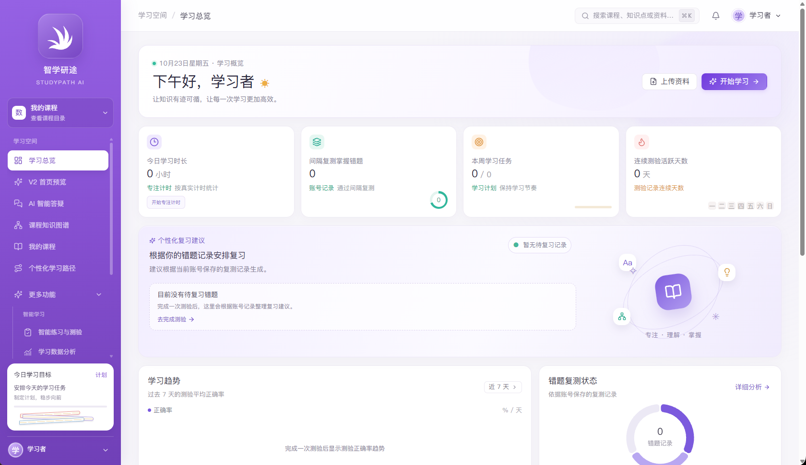

首页是学生进入系统后的学习驾驶舱。顶部欢迎区提供上传资料和开始学习的快捷入口；中部数据卡片汇总当日专注时长、间隔复测掌握错题、本周学习任务及连续测验活跃天数；个性化复习建议区域根据账号保存的记录给出复习提示；下方还可查看学习趋势、错题复习状态和需要关注的知识点。

首次使用或没有相关记录时，统计值可能为 0、横线或空状态。这些显示表示当前账号尚无可统计记录或该项尚未计算，并不代表系统故障或学习效果为零。页面数据以当前登录账号和后端保存记录为准。

1. 登录后先确认右上角显示的账号身份，再查看首页数据。
2. 从任务卡片进入本周计划，从复习建议进入测验或错题复习，从课程卡片继续上次学习。
3. 点击“上传资料”进入学习资料库；点击“开始学习”进入课程/任务学习入口。
4. 完成练习、计划或专注操作后返回首页刷新，观察相应指标是否更新。

**图 2　V2 首页：欢迎入口、学习指标与课程卡片**

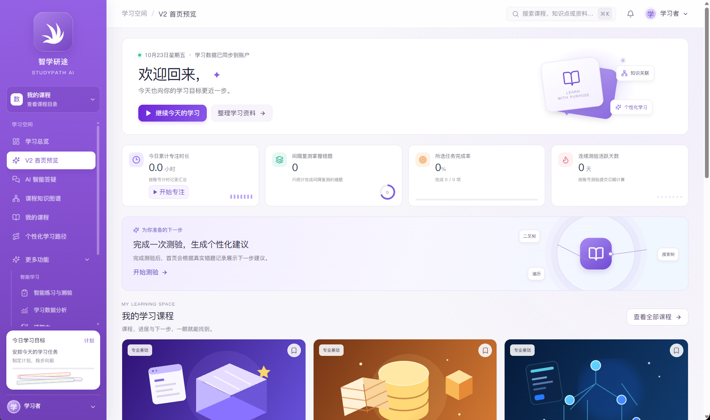

V2 首页在欢迎区之外，以课程卡片呈现学生当前可学习课程、课程知识点数量、当前章节和个人进度。学生可通过“继续学习”进入课程，也可查看全部课程。中上部指标可快速了解专注、复测、任务完成率和连续学习情况；“完成一次测验，生成个性化建议”等区域提示学生通过实际学习活动形成后续建议。页面下半部延续到课程列表和学习趋势，需向下滚动查看完整内容。

**图 3　V2 首页下部：课程知识图谱预览与学习计划入口**

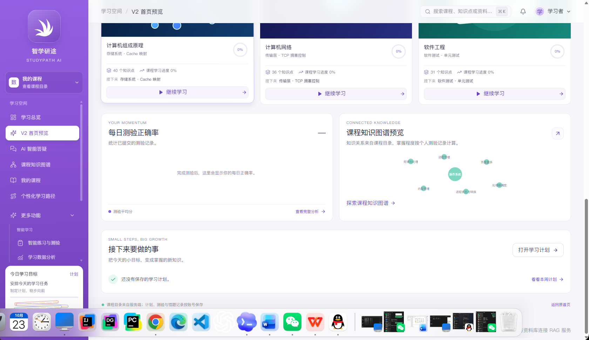

首页下部提供课程知识图谱预览和“接下来要做的事”区域。图谱预览以简化节点展示课程内知识联系，可点击“探索课程知识图谱”进入完整交互视图；计划卡片则提示当前是否已有学习计划，并提供打开学习计划的入口。该截图拍摄时浏览器底部系统 Dock 同时可见，平台内容仍完整呈现；实际操作应以浏览器中的页面控件为准。

### 7.2 上传资料并建立个人知识库

**图 4　学习资料库：创建知识库、上传资料并查看索引状态**

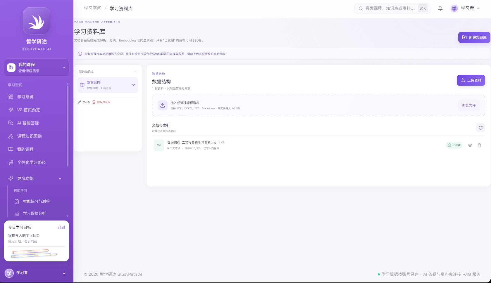

学习资料库用于按主题或课程管理个人学习文件。左栏显示当前账号可见的知识库；主区域显示选中知识库、关联课程、文件拖放/浏览入口和文档处理状态。示例中知识库名为“数据结构”，其中一份 Markdown 文件显示已就绪，说明该文档完成了解析与索引，可以作为问答检索范围。文档数量和状态会随账号实际上传与处理结果变化。

1. 点击“新建知识库”，填写便于识别的名称；如有课程关联选项，可选关联课程后创建。
2. 进入新知识库，点击“上传资料”或“浏览文件”，也可使用页面提供的拖放区域添加文件。
3. 确认文件格式、大小和内容符合页面限制。建议先按课程/主题拆分资料，并使用清晰的文件名。
4. 上传后等待服务端解析、分块和索引。列表状态变为“已就绪”后再开始问答；处理中或失败状态的文档不一定可被检索。
5. 使用预览功能抽查标题、段落、表格和公式的解析质量。扫描版 PDF 如果没有文本层，需确认部署端是否启用 OCR。
6. 可以根据课程或主题继续创建多个知识库。删除文件或知识库前，先确认相关对话是否仍依赖其资料。

学习资料库说明的“本地资料检索”是指系统在账号授权和所选知识库范围内检索已上传资料。文本生成服务可能由部署环境连接本机或远程模型，用户应以部署配置及隐私政策为准。

### 7.3 我的课程：浏览当前课程目录

**图 5　我的课程：课程卡片、章节入口与个人进度**

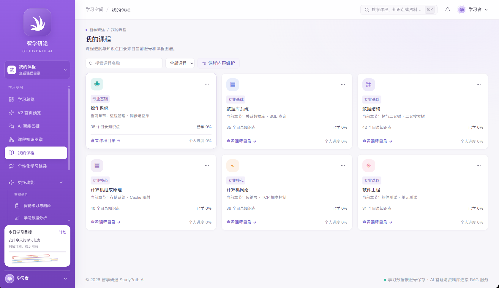

“我的课程”集中展示当前课程目录。卡片包含课程名称、分类、当前章节、目录知识点数量和个人掌握进度。课程卡片上的“查看课程目录”用于展开章节与知识点清单；课程搜索、分类筛选和课程内容维护入口可帮助用户快速定位课程。学生查看的个人进度来自当前账号记录，不同账号可能不同。

1. 点击左侧“我的课程”。
2. 通过搜索框输入课程名称，或通过课程分类下拉项筛选课程。
3. 查看课程卡片的当前章节、知识点总量和个人进度，点击“查看课程目录”。
4. 在课程目录中选择章节或知识点，阅读内容并进入练习。完成练习后返回目录查看个人掌握度变化。
5. 若课程、章节或知识点缺失，联系课程管理员检查课程目录维护数据。

**图 6　课程目录弹窗：逐项查看知识点掌握度并进入图谱**

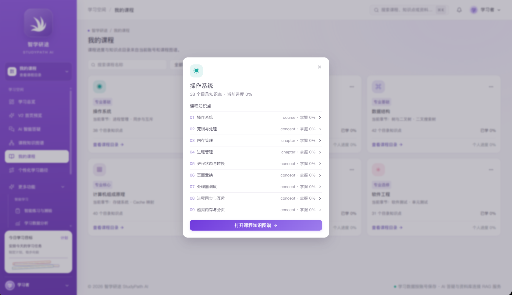

课程目录以编号列表展示课程节点和知识点。截图中的“操作系统”目录包含课程级、章节级及知识点级条目，每项显示节点类型和当前账号掌握度；底部提供打开课程知识图谱的入口。学生可从目录定位学习对象，再使用页面的知识点入口进行练习，避免只浏览课程名称而缺少明确学习目标。

### 7.4 课程知识图谱：查看先修和关联关系

**图 7　操作系统课程知识图谱：课程、章节与知识点的关联结构**

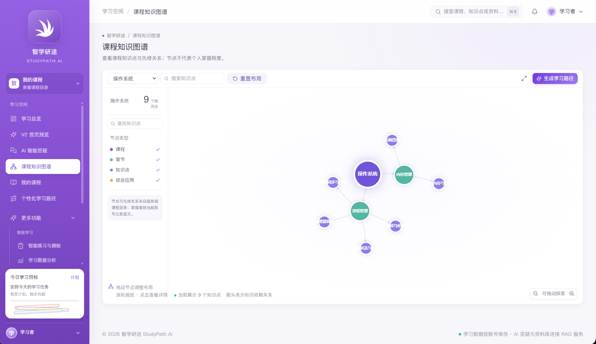

图谱将课程主题显示为中心节点，将章节或知识点显示为关联节点，并以连线表示课程目录中维护的依赖关系。截图示例共有 9 个节点，包含“操作系统”“内存管理”“进程管理”以及页面置换、虚拟内存、进程同步等知识点。节点类型使用不同颜色区分。图谱中的连线帮助学生理解学习顺序和主题联系，个人掌握度仍以账号练习记录为准，节点位置和连线不能直接解释为成绩。

1. 从课程目录或首页图谱预览进入完整图谱。
2. 使用顶部课程选择器切换课程；输入关键词搜索课程、章节或知识点。
3. 在左侧节点类型列表切换显示类别；拖动节点整理视图，滚动缩放，必要时点击“重置布局”。
4. 选择节点查看其说明或进入相关学习功能；关注先修知识关系，优先补足基础节点。
5. 点击“生成学习路径”可依据当前课程图谱与账号学习记录进入推荐路径。

若图谱显示 0 个节点，应先检查当前课程是否具有目录和节点关系数据，确认课程服务加载成功后重新选择课程或刷新。上传资料不会自动等同于课程目录数据；资料解析、课程图谱生成和管理员维护属于不同的数据流程，只有系统当前启用相应处理流程时才会建立对应节点。

### 7.5 个性化学习路径：参考建议并保留选择权

**图 8　个性化学习路径：推荐步骤、学习目标与路径调整入口**

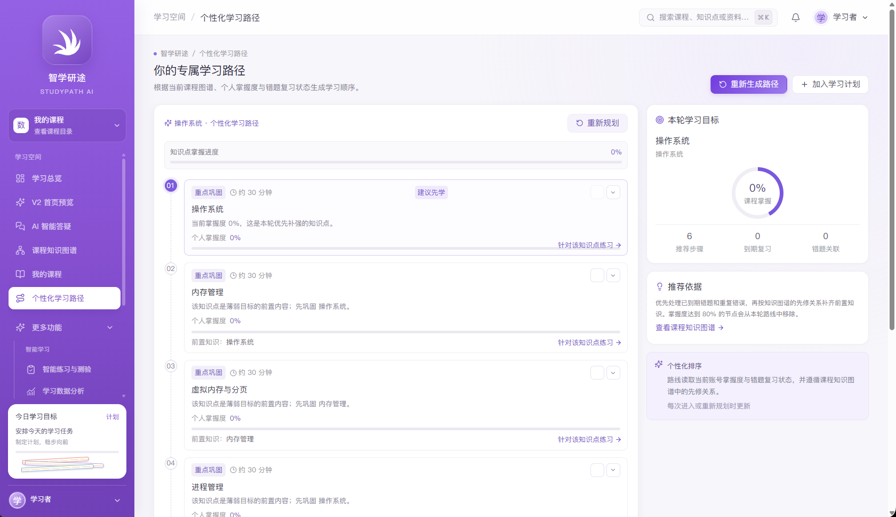

个性化学习路径把课程知识图谱转化为可执行步骤。页面展示课程知识点掌握进度、本轮学习目标、推荐步骤数量以及每个步骤的建议时长、优先标签、推荐理由和前置知识。示例先推荐巩固课程主题，再安排后续章节和知识点；对于尚未掌握的前置内容，路径会提示先学或先巩固。右侧信息卡说明推荐依据，并提供查看知识图谱的入口。

系统将路径作为建议：学生可以按自身考试安排、兴趣和可投入时间决定是否采用。可通过步骤卡片中的勾选/展开控件查看和调整步骤，并使用“重新生成路径”或“重新规划”更新建议；“加入学习计划”将选定路径转成可执行任务。建议会受课程图谱、当前账号掌握记录和错题复习状态影响；数据不足时结果可能较少或为空。

1. 选择要学习的课程，查看知识掌握进度和本轮学习目标。
2. 先阅读路径步骤的“建议先学”“重点巩固”和前置知识提示。
3. 根据个人目标保留、调整或跳过建议步骤；路径不替学生作最终决定。
4. 使用“针对该知识点练习”开始指定知识点练习，或将学习路径加入学习计划。
5. 完成练习并保存结果后重新规划，让新的掌握记录参与下一轮建议。

### 7.6 自定义学习计划与优先级

**图 9　我的学习计划：按日期安排任务并设置优先级**

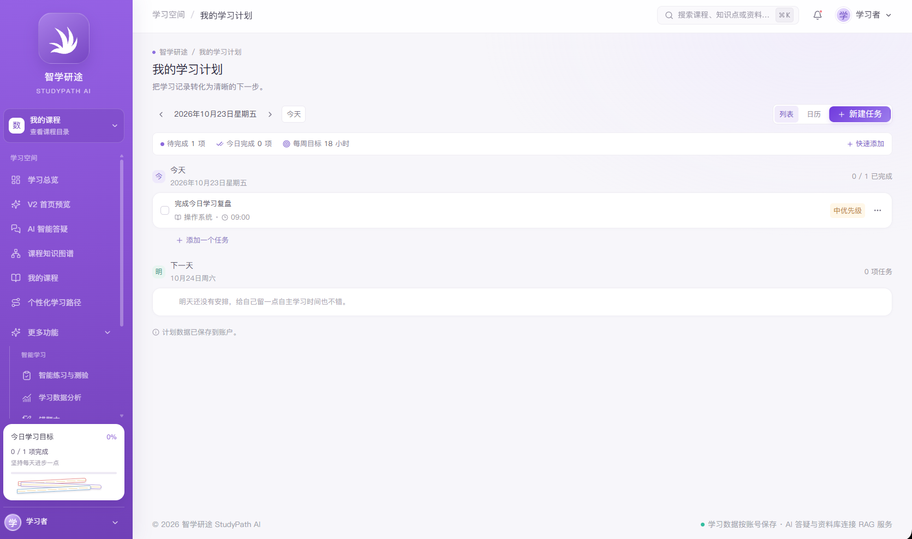

“我的学习计划”将学习建议落实为日期任务。页面顶部显示日期导航、待完成/今日完成统计、每周目标以及列表和日历视图；主区域按日期分组显示任务。示例任务“完成今日学习复盘”关联“操作系统”，并标记为“中优先级”。这些字段表明学生可以自行安排任务内容、课程归属、日期和优先程度，学习路径推荐最终由学生决定是否纳入计划。

1. 从侧边导航打开“我的学习计划”，使用日期箭头切换日期，点击“今天”返回当天。
2. 点击“新建任务”填写任务名称、日期、课程、时间等信息，并选择适合的优先级；也可用“快速添加”快速记录待办。
3. 保存后检查任务是否出现在正确日期。任务卡片的复选框用于更新完成状态，更多菜单可查看可用的编辑操作。
4. 根据考试期限、知识点难度和前置关系调整优先级。高优先级用于提示先处理，不会自动更改课程知识图谱。
5. 路径页的“加入学习计划”可承接推荐步骤；加入后仍可在计划页修改任务日期、内容和优先级。
6. 查看顶部待完成、今日完成和每周目标，区分计划配置值与实际完成记录。

计划在保存成功后应与账号关联。若刷新后任务消失，检查保存状态、登录账号及网络请求结果，再重新进入页面确认。

### 7.7 智能练习与知识点检测

**图 10　针对知识点的智能练习：处理器调度题目**

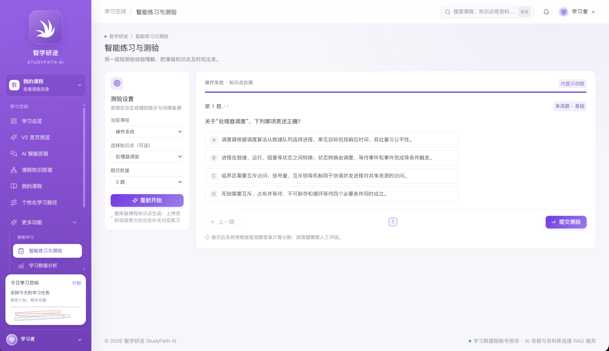

**图 11　针对知识点的智能练习：虚拟内存与分页题目**

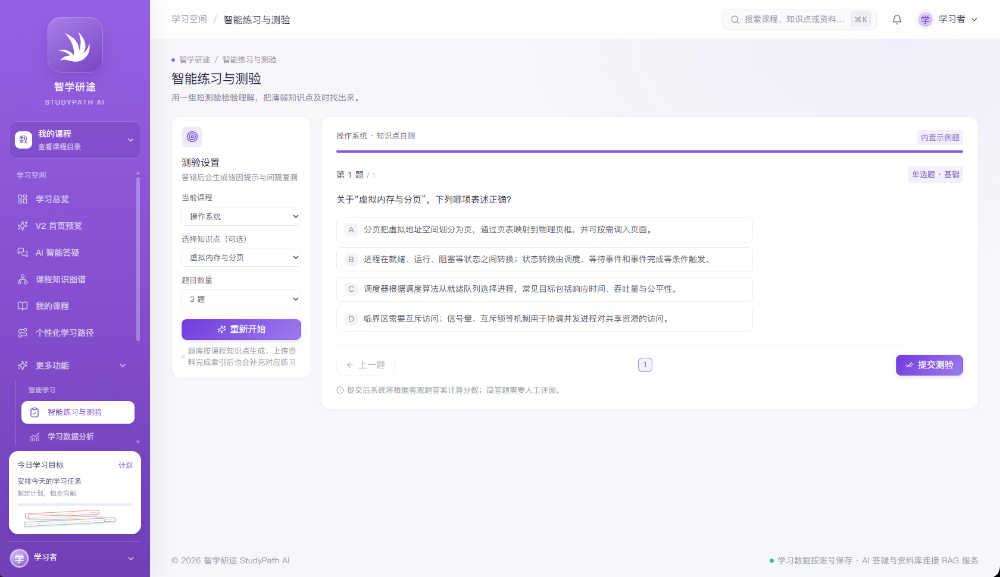

智能练习可从侧边栏进入，也可从课程目录或个性化路径的知识点练习入口发起。由知识点入口进入时，练习页显示当前课程及知识点，例如“操作系统·处理器调度”或“操作系统·虚拟内存与分页”，题目围绕所选概念展开。图中题目提供单选选项、题目进度和提交按钮，方便学生在完成后及时检查理解情况。

1. 通过“针对该知识点练习”进入练习页；也可在练习设置中选择课程、可选知识点和题量。
2. 阅读题干，选择最符合题意的选项。提交前可检查答案，按题目导航查看当前进度。
3. 点击“提交测验”，等待系统返回判分结果；查看正确答案、解析和知识点提示。
4. 对答错题目，系统将其记录到当前账号错题本，并提供查看解析和后续复习的入口。答题记录保存情况以提交结果为准。
5. 在错题本选择“原题+变式复测”时，系统围绕原题考查的知识点生成或选择变式题；学生应关注解题方法能否迁移到新条件，而不只是记住原选项。
6. 复测后检查答题结果和错题状态，仍未掌握的题目继续安排复习；已掌握题目可按复习间隔再次确认。

当前两张练习图展示的是题目作答界面，没有展示答错后的结果页或错题本列表，因此它们用于说明知识点练习入口和答题操作。错题归集与变式复测流程按系统功能逻辑说明。不同课程题库和部署配置会影响可用题型、题量和变式生成方式。

### 7.8 错题本：重复练习直至掌握

错题本汇集当前账号的错误答题记录。学生可以从错题本定位课程、知识点和题目，查看自己的作答、正确答案及解析，并按复习安排重新作答。原题复习用于检查是否真正记住解题逻辑；变式复测则调整题目条件或表述，帮助检查是否能举一反三。

在错题卡片中点击“举一反三练习”后，系统会进入独立练习页面，围绕原题考查的知识点生成三道不同情境的新单选题。生成期间页面会显示等待状态；生成后可逐题作答、提交并查看答案解析。模型服务响应时间受部署和网络情况影响；如生成失败，可在页面重试。

**图 15　举一反三练习：三道变式题生成中的等待状态**

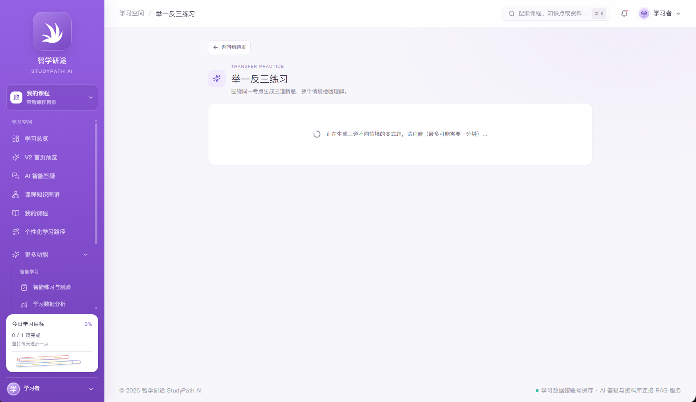

**图 16　举一反三练习：三道新题及选项**

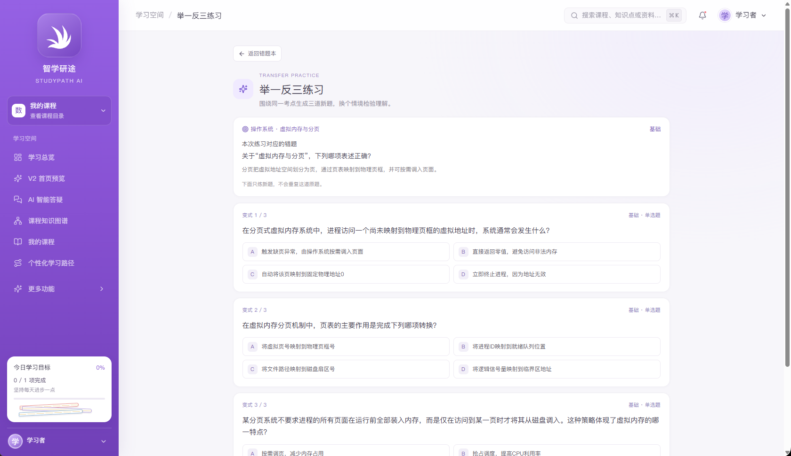

1. 在“更多功能”中打开“错题本”，按课程或复习状态筛选条目。
2. 打开题目先回忆自己的原始判断，再阅读答案和解析，记录错误原因。
3. 点击“举一反三练习”，等待新题生成；三道题不会重复原题。若页面提示生成失败，检查后端模型服务和网络配置后再重试。
4. 完成三道题并提交，查看每道题的正确答案和解析。
5. 根据新结果更新复习状态；仍答错的题目继续留在复习范围，确认掌握的题目按间隔复测安排巩固。
6. 若错题本为空，先完成至少一次已保存的练习，并确认答错题目已提交。

### 7.9 AI 智能答疑：围绕个人资料检索作答

**图 12　AI 智能答疑：问题回答与引用来源核对**

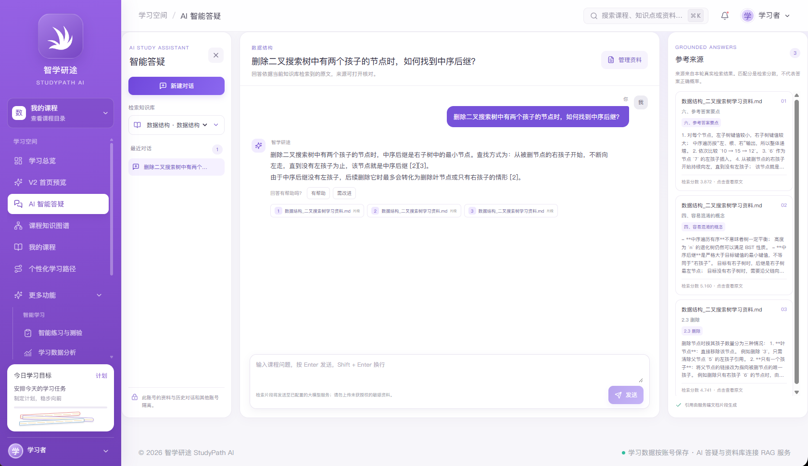

AI 智能答疑是平台的重要特色。学生选择个人知识库后，可针对资料内容提出问题。示例问题询问“删除二叉搜索树中有两个孩子的节点时，如何找到中序后继？”，回答围绕二叉搜索树删除操作解释中序后继，并在右侧“参考来源”栏列出匹配文档、来源片段、检索分数和查看原文入口。该界面将问题、回答和检索证据放在同一页面，学生可以沿引用回到上传材料核对依据。

问答流程包括：限定所选知识库和账号权限；检索与问题相关的资料片段；对候选片段排序并检查是否具有足够证据；再根据部署所配置的生成模型组织回答，并展示引用来源。资料越完整、问题越具体，越有利于检索到相应内容。检索分数反映系统的匹配排序信号，不是答案正确率或置信概率。

1. 确认目标知识库中文档状态为“已就绪”，然后打开“AI 智能答疑”。
2. 在左侧选择知识库并创建或打开对话。提问时尽量写明课程、章节、概念或需要比较的对象。
3. 阅读回答并查看右侧参考来源，点击对应片段或“查看原文”核对上下文。
4. 如回答缺少关键条件，可继续追问并补充问题范围；也可以回资料库确认相关章节是否已上传和成功索引。
5. 没有可靠证据时，系统可能提示无法根据当前资料回答。此时应补充资料或调整问题，不能把无来源的推测当成资料结论。
6. 问答失败时确认所选知识库、索引状态、后端检索服务和模型服务配置。

个人资料检索受账号和知识库范围限制。回答内容由检索证据与模型生成共同形成，仍需由学习者核对引用原文；重要课程结论应以教材、教师和权威资料为准。

### 7.10 学习数据分析与学习复盘

学习数据分析将已保存的测验、任务和错题复习记录转化为趋势或状态统计。学生可查看一定周期内的测验正确率、完成任务、学习时长和需要关注的知识点，也可以从分析页面跳转错题本继续复习。首页和分析页统计口径可能不同，应阅读页面标注的周期和数据来源。

推荐的复盘方式是：先检查近期错题和待复测知识点，再对照课程图谱查看前置知识，随后安排一项具体学习任务并设定优先级。完成任务后做一次练习或测验，将结果保存后再查看下一轮建议。若没有历史数据，图表可能为空或显示“—”，待真实记录产生后再进行比较。

## 8. 课程管理员手册

### 8.1 进入课程内容维护

**图 13　课程内容维护：管理员验证、课程和知识点表单**

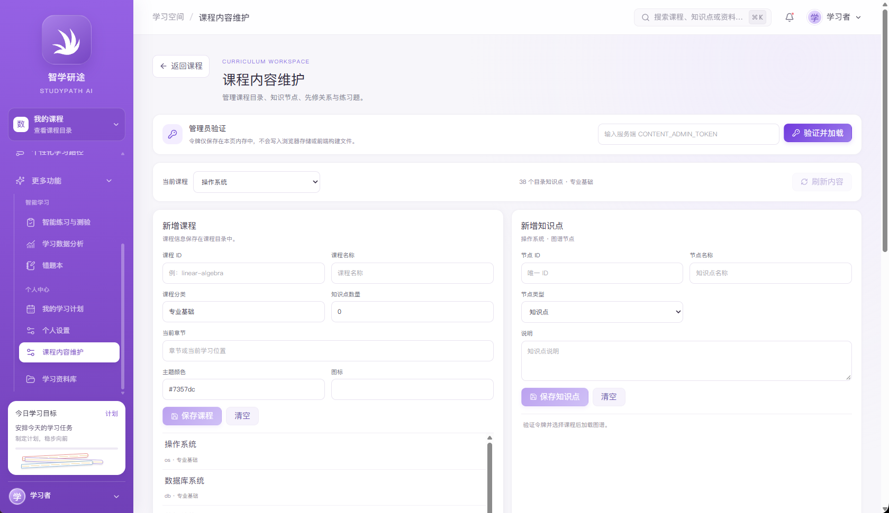

课程内容维护用于管理学生侧课程目录、知识点、关系及练习题。页面顶部要求输入服务端配置的课程维护令牌并验证加载；令牌仅用于当前页面操作，不写入浏览器持久存储。未验证前，课程和图谱数据不会加载，保存控件也可能处于不可用状态。令牌应由部署管理员通过安全渠道提供，不能写入公开文档或截图。

界面包含新增课程和新增知识点表单。新增课程可填写课程 ID、课程名称、课程分类、知识点数量、当前章节、主题颜色和图标；新增知识点可填写唯一 ID、名称、节点类型及说明。页面下方显示已有课程清单，便于核对维护对象。

1. 进入“课程内容维护”，在管理员验证区域输入有效令牌并点击“验证并加载”。
2. 从当前课程下拉框选择要维护的课程，先核对课程名称及目录数量。
3. 新增课程时，填写稳定且唯一的课程 ID、课程名称和分类；检查知识点数量及当前章节等展示信息后保存。
4. 新增知识点时，选择对应课程并填写唯一节点 ID、名称、类型和说明。节点类型用于课程/章节/知识点/应用等结构组织。
5. 保存后刷新或重新加载课程内容，检查学生侧课程目录和图谱数据是否出现。
6. 清空表单只清除当前未保存输入；保存操作才会将内容提交到后端。

### 8.2 定义课程先修关系并维护练习题

**图 14　课程内容维护下部：先修关系和新增练习题**

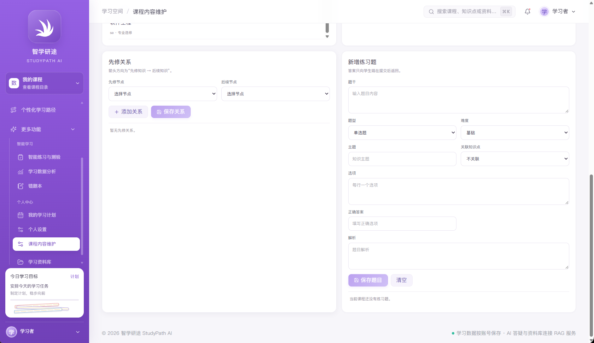

先修关系用于表达学生学习两个知识点时的建议顺序。页面分别选择先修节点与后续节点，添加关系后保存。图谱可据此形成知识点之间的依赖连线，个性化学习路径也可据此优先安排基础节点。配置关系前应确认方向：箭头从先修知识指向后续知识，不能把后续节点反向设置为前置节点。

新增练习题表单包含题干、题型、难度、主题、关联知识点、选项、正确答案和解析等字段。题目关联知识点后，学生可以从该知识点进入练习，答题记录和错题复习也能回到相应主题。

1. 在“先修关系”区域选择先修节点和后续节点，点击“添加关系”检查关系列表。
2. 确认方向、课程归属及节点存在后点击“保存关系”；避免重复添加或建立循环依赖。
3. 在“新增练习题”区域输入完整题干，选择题型和难度，填写主题并关联知识点。
4. 按题型要求逐行填写选项和正确答案，补充足以说明判断依据的解析。
5. 点击“保存题目”，确认题目出现在当前课程题库，并在学生侧对应知识点进行抽查。
6. 课程或关系调整后刷新学生侧课程目录、知识图谱和学习路径，检查数据一致性。

课程维护人员应保证课程 ID 和节点 ID 唯一、关系方向准确、题目答案与解析一致。删除或修改被路径、测验、错题引用的节点前，应先评估对既有记录和页面入口的影响。

## 9. 数据处理流程与页面联动

### 9.1 课程、图谱与学习路径

管理员维护课程、知识点和先修关系后，学生侧课程目录读取相同课程数据。图谱根据课程节点与关系绘制；学习路径再结合当前账号掌握度、错题状态和复习时点排序推荐内容。学生提交练习后，服务端保存答题记录并用于更新掌握和复习信息。首页、我的课程、路径和分析页通过各自数据接口显示更新后的状态。

课程数据的全局结构与个人掌握度分属不同数据层：同一门课可共享课程目录，但不同学生看到的个人进度、错题和推荐步骤可以不同。课程内容变化后，个人数据不会自动等同于新课程数据，需按系统页面提示重新加载或重新规划。

### 9.2 资料上传与 AI 检索问答

上传资料后，服务端校验文件、提取文本并保留来源元数据；按配置将文本切分为可检索片段，使用嵌入模型建立向量索引。提问时，后端按当前账号和选中知识库限制检索范围，召回候选资料、排序并进行证据检查。满足条件后再调用部署所配置的生成模型组织答复，同时返回关联的文件和片段来源。

资料索引状态是问答可用性的前提。只有处理成功的文档片段才适合作为检索证据。删除或替换资料时，应检查相关索引是否同步更新。复杂表格、扫描件、公式和图片内容可能解析不完整，需通过预览抽检。

## 10. 常见问题与处理

| 现象 | 处理建议 |
|---|---|
| 首页数据为 0 或“—” | 确认账号正确；对应测验、专注或计划记录保存成功后刷新页面。空状态不能说明功能未运行。 |
| 学习资料库没有知识库 | 点击“新建知识库”填写名称并创建；如按钮无响应，检查浏览器报错及知识库 API 状态。 |
| 文件上传后一直处理中 | 核对文件格式/大小、解析任务、文件权限、向量服务及后端日志。 |
| 文档显示已就绪但 AI 没有来源 | 确认当前选择了该知识库，问题涉及文档内容，检查索引和检索服务。 |
| AI 答案与原文不符 | 打开右侧引用核对上下文；调整问题或补充资料。检索分数不是答案正确率。 |
| 我的课程没有课程卡片 | 检查课程服务、当前账号和课程目录部署数据。 |
| 知识图谱显示 0 个节点 | 选择正确课程，检查课程知识点和关系是否维护并已保存。上传资料不必然自动变成课程图谱节点。 |
| 个性化路径为空 | 确认课程已有节点关系，且已选择课程；完成练习以提供个人掌握与错题记录后重新规划。 |
| 练习没有题目 | 检查课程题库是否有题目、题目是否关联知识点以及题库接口。 |
| 答错题没有出现在错题本 | 确认测验已提交并保存，账号未切换；重新加载错题本并核对筛选条件。 |
| 学习计划刷新后消失 | 确认页面提示保存成功，检查日期、账号身份和后端请求结果。 |
| 管理员维护按钮不可用 | 先使用服务端管理员令牌验证并加载；确认当前课程已选择。 |
| 先修关系方向不符合预期 | 按“先修知识 → 后续知识”核对两个节点，再保存并刷新图谱。 |

## 11. 安全、隐私与使用限制

1. 课程维护令牌和模型密钥只由授权维护人员通过安全配置管理，不应放入前端代码、截图或公开仓库。
2. 个人资料和学习记录应按照账号权限使用。公共电脑退出账号并关闭会话。
3. 资料问答的结果依赖文档解析、索引质量、检索排序和模型生成。用户应通过引用核实重要结论。
4. 学习路径是辅助建议，不能替代教师指导、课程大纲或学生本人对学习目标的选择。
5. 个性化统计依赖已保存的账号记录。首次使用或没有历史记录时，页面会显示空状态或未计算值。
6. 扫描件、复杂排版、表格、图像和公式可能无法准确提取；上传后应检查解析预览。
7. 课程目录、题目和图谱的可用性取决于管理员配置与后端数据；资料库文件不会自动等同于课程题库。

## 附录 A：截图索引

| 图号 | 截图内容 | 对应章节 | 用途 |
|---|---|---|---|
| 图 1 | 学习总览首页 | 7.1 | 学习状态、复习建议、上传资料及开始学习入口 |
| 图 2 | V2 首页上部及课程卡片 | 7.1 | 学习指标、课程目录和继续学习入口 |
| 图 3 | V2 首页图谱预览及计划入口 | 7.1 | 从首页发现课程图谱与计划功能 |
| 图 4 | 学习资料库 | 7.2 | 创建知识库、上传资料和文档索引状态 |
| 图 5 | 我的课程 | 7.3 | 课程卡片及个人进度 |
| 图 6 | 课程目录弹窗 | 7.3 | 章节/知识点清单、掌握度和图谱入口 |
| 图 7 | 课程知识图谱 | 7.4 | 课程节点、知识点和关联关系 |
| 图 8 | 个性化学习路径 | 7.5 | 推荐步骤、理由、复习指标和调整入口 |
| 图 9 | 自定义学习计划 | 7.6 | 按日期安排任务及优先级 |
| 图 10 | 处理器调度练习 | 7.7 | 指定知识点的练习题与提交操作 |
| 图 11 | 虚拟内存练习 | 7.7 | 另一知识点练习示例 |
| 图 12 | AI 智能答疑 | 7.9 | 基于资料回答并展示参考来源 |
| 图 13 | 课程维护主界面 | 8.1 | 管理员验证、课程和知识点维护 |
| 图 14 | 先修关系与题目维护 | 8.2 | 配置先修顺序并新增课程练习题 |
| 图 15 | 举一反三练习生成状态 | 7.8 | 查看三道变式题生成中的等待状态 |
| 图 16 | 三道新变式题 | 7.8 | 对新题作答并提交查看解析 |

## 附录 B：术语

- **知识库**：由当前账号创建、用于管理个人学习文件的逻辑空间。
- **索引就绪**：文档已完成必要解析和检索索引处理，可进入资料问答范围。
- **知识点掌握度**：根据账号学习记录形成的个人学习状态指标，不是课程全局属性。
- **先修关系**：说明学习后续知识前建议具备的前置知识关系，方向为先修节点指向后续节点。
- **变式复测**：针对原题所考查的知识点，用不同表述或条件再次检查迁移理解的练习。
- **RAG 检索问答**：先检索资料证据，再据证据生成回答并展示引用来源的问答方式。
