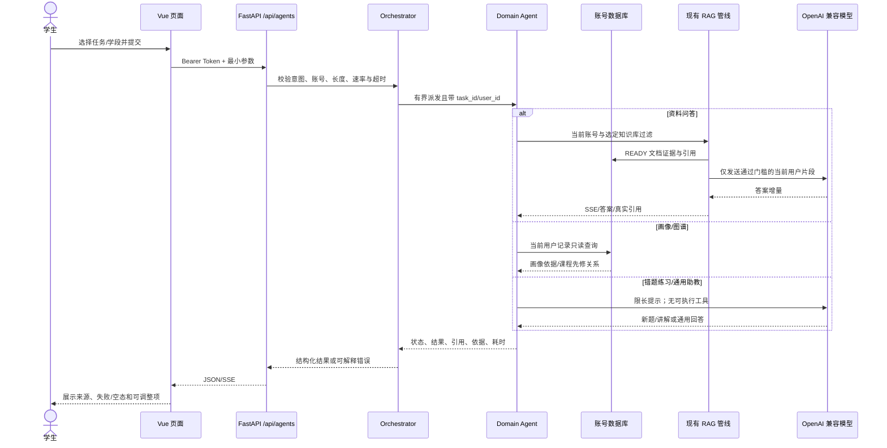

# 多智能体架构与隐私边界

## 角色

| 角色 | 输入范围 | 已允许的服务/工具 | 写入边界 |
|---|---|---|---|
| 调度智能体 | 当前登录用户的请求意图与最小任务参数 | 固定意图路由表、超时/并发/限流器 | 不直接写课程或图谱 |
| 用户画像分析 | 本账号画像、近期测验/错题、课程掌握记录和计划 | 只读 SQL 查询；可配置模型做受限摘要 | 只返回带依据的可调整建议；不自动更改计划 |
| 错题分析与迁移 | 本账号错题、原题解析、知识点与学段 | 现有变式题模型流程与确定性格式/重复检查 | 生成集合短期归属当前用户；只有用户提交后才更新错题记录 |
| 本地资料问答 | 当前用户拥有且显式选择的知识库和会话 | 现有 retrieve/answer/stream_answer、证据门槛及引用 | 仅按现有会话 API 保存已完成轮次 |
| 大模型助教 | 当前问题、用户选择的学段；不读取本地资料 | 后端 OpenAI 兼容 Chat Completions Provider | 只回答，不调用工具、不访问其他用户资料 |
| 图谱分析 | 被选择课程的正式节点/边及当前用户掌握度 | 只读 SQL 图谱查询和先修遍历 | 模型不能直接写正式图谱；维护继续走管理员 API |

## 调度与调用顺序

## 数据与隐私边界

- Bearer Token 在 API 入口解析成账号身份；每次 ORM 查询按 `user_id` 或知识库 `owner_id` 过滤。客户端不得传入用于冒充他人的 owner ID。
- 画像 Agent 只取完成当前建议需要的账号记录；不把完整账号历史广播给其他角色。图谱 Agent 返回数据库中真实节点/边，不使用 LLM 补造关系。
- 资料片段只有用户选择本地资料问答并通过现有证据门槛后才传给配置的模型服务。通用模型模式不读取知识库。
- AgentHarness 凭证绝不传给 DeepSeek/其他 LLM；未知协议的外部 AgentHarness 调用禁用。
- 日志只记录 task_id、角色、意图、状态、耗时和错误类型；不记密钥、请求正文、原文资料或完整回答。
- Agent 响应统一带 `status`、`task_id`、`intent`、`evidence`、`citations`、`result`、`error`、`elapsed_ms`。失败与证据不足不伪装成答案。

